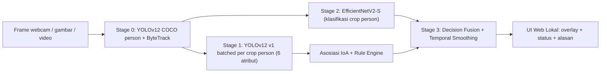

# attire-compliance

Sistem deteksi etika berpakaian mahasiswa secara real-time berbasis **YOLOv12** (deteksi 6 atribut pakaian) dan **EfficientNetV2-S** (klasifikasi kepatuhan *Sesuai / Tidak Sesuai*), dilengkapi aplikasi demo web lokal **100% offline**.

> Tugas Akhir — *Implementasi Sistem Deteksi Etika Berpakaian Mahasiswa menggunakan Metode YOLOv12 dan EfficientNetV2*
> Program Studi Teknologi Rekayasa Elektronika, Politeknik Negeri Batam.

---

## Quickstart (Langsung Siap Pakai)

Seluruh bobot model terlatih (`yolo12n.pt`, `yolo12n_attire_v1.pt`, dan `effnetv2s_compliance_v1.pt`) sudah disertakan di folder `models/`.

### Kebutuhan Sistem
- Windows 10/11 atau Linux
- Python 3.12 (dikelola otomatis oleh `uv`)
- GPU NVIDIA dengan driver terbaru (dikembangkan & diuji pada RTX 4050 Laptop 6 GB VRAM — *CUDA Toolkit tidak perlu diinstal terpisah*)
- Webcam (untuk mode Live Webcam)

### Instalasi & Menjalankan Aplikasi

```powershell
# 1. Install uv (sekali saja bila belum ada)
winget install --id=astral-sh.uv -e

# 2. Clone repositori
git clone https://github.com/godlovesmei/attire-compliance.git
cd attire-compliance

# 3. Install dependensi (versi terkunci di uv.lock)
uv sync

# 4. (Opsional) Verifikasi GPU & inference FP16
uv run attire doctor

# 5. Jalankan aplikasi demo lokal (100% offline)
uv run attire serve
```

Buka **`http://127.0.0.1:8000`** di browser.

---

## Fitur Aplikasi Demo

- **3 Mode Input:** Live Webcam, Upload Gambar (JPG/PNG), dan Upload Video (MP4/MOV/WEBM) melalui WebSocket biner dengan *backpressure* (tanpa penumpukan latensi).
- **Single-Screen Studio UI (100% Offline):** Viewport kamera dan panel analisis tampil bersamaan tanpa perlu scroll.
- **Deteksi Multi-Mahasiswa:** Pelacakan ByteTrack per orang dengan pemilih mahasiswa (`track_id`).
- **Panel Evaluasi Real-Time:** Status akhir (`SESUAI` / `TIDAK SESUAI` / `BELUM LENGKAP`) beserta alasan spesifik, probabilitas EfficientNetV2-S, dan checklist confidence 6 atribut YOLOv12.
- **Kontrol & Ekspor:** Slider *confidence threshold* live, tombol **Capture** (simpan frame JPG + metadata JSON), serta **Export CSV / JSON** log sesi ke `outputs/sessions/`.

---

## Arsitektur Pipeline Hybrid



1. **Stage 0 — Deteksi & Tracking Orang:** YOLOv12 pretrained COCO (`models/pretrained/yolo12n.pt`, kelas `person`) + ByteTrack melokalisasi setiap mahasiswa dengan ID track stabil.
2. **Stage 1 — Deteksi 6 Atribut Pakaian:** YOLOv12 fine-tuned (`models/detector/yolo12n_attire_v1.pt`) dijalankan *batched* pada tiap crop orang + NMS per kelas + asosiasi IoA ($\ge 0.50$).
3. **Stage 2 — Klasifikasi Holistik:** `timm` EfficientNetV2-S (`models/classifier/effnetv2s_compliance_v1.pt`, letterbox `224×224`, normalisasi ImageNet) menilai kepatuhan visual crop seluruh tubuh tiap mahasiswa.
4. **Stage 3 — Decision Fusion & Temporal Smoothing:** Rule engine deterministik digabung dengan probabilitas EfficientNetV2-S (mendukung mode ablation `fusion`, `rule_only`, `classifier_only`), lalu dihaluskan dengan mayoritas 15 frame per track ID.

### 6 Kelas Atribut Terkunci (`configs/classes.yaml`)

| ID | Kelas | Keterangan | Peran |
|---:|---|---|---|
| 0 | `pakaian_berkerah` | Kemeja atau polo berkerah | Wajib (atau ID 1) |
| 1 | `jas_almamater` | Jas almamater Polibatam / blazer lapel formal | Wajib (atau ID 0) |
| 2 | `kaos_oblong` | Kaos tanpa kerah (dikecualikan bila tertutup `jas_almamater`) | Pelanggaran |
| 3 | `bawahan_panjang` | Celana panjang formal, jeans panjang, atau rok panjang | Wajib |
| 4 | `sepatu` | Sepatu tertutup | Wajib |
| 5 | `sandal` | Sandal atau alas kaki terbuka | Pelanggaran |

### Aturan Kepatuhan

- **SESUAI:** (`pakaian_berkerah` atau `jas_almamater`) **dan** `bawahan_panjang` **dan** `sepatu`, tanpa pelanggaran aktif, dan tidak ditolak EfficientNetV2-S ($\tau_{\text{veto}} = 0.80$). *Kaos oblong yang tertutup `jas_almamater` tetap dinilai **SESUAI**.*
- **TIDAK SESUAI:** Terdeteksi `sandal`, atau `kaos_oblong` tanpa `jas_almamater`, atau atribut wajib tidak terpenuhi, atau ditolak EfficientNetV2-S dengan keyakinan tinggi.
- **BELUM LENGKAP:** Kaki/tubuh terpotong tepi bawah kamera (khusus UI live).

Seluruh threshold dan mode fusion dapat disesuaikan pada [`configs/app.yaml`](configs/app.yaml).

---

## Ringkasan Evaluasi Model `v1` (Test Set — RTX 4050 Laptop 6 GB)

- **Detektor YOLOv12n `v1` (1.199 gambar test / 3.108 box):** Precision `0.6520` · Recall `0.6248` · **mAP@50 `0.6531`** · mAP@50-95 `0.4904` (`sepatu` `0.8773`, `bawahan_panjang` `0.8352`, `jas_almamater` `0.6191` — pada subset uji lokal Polibatam, `jas_almamater` mencapai **AP@50 `0.8392`** / Recall `90.0%`).
- **Classifier EfficientNetV2-S `v1` (458 crop test):** Accuracy **`85.37%`** (Val `89.36%`) · Macro-F1 **`0.7865`** · **ROC-AUC `0.8808`** · Recall `tidak_sesuai` **`89.50%`**.
- **End-to-End Pipeline Ablation (586 person GT):**
  - `fusion`: Accuracy **`90.61%`** · Recall `tidak_sesuai` **`97.57%`** · Macro-F1 `0.7955`
  - `rule_only`: Accuracy **`91.13%`** · Recall `tidak_sesuai` **`97.57%`** · Macro-F1 `0.8098`
  - `classifier_only`: Accuracy **`88.40%`** · Recall `tidak_sesuai` `91.28%` · Macro-F1 `0.7982`
- **Benchmark Kecepatan (300 frame, `640px`, FP16, rata-rata 2,52 orang/frame):** `91.09 ms` (**10.98 FPS** multi-orang; ~18–22 FPS pada skenario 1 mahasiswa).

---

## Perintah CLI (`attire`)

Jalankan `uv run attire --help` untuk daftar lengkap perintah.

```powershell
# Aplikasi & diagnostik
uv run attire doctor                  # Cek Python, GPU CUDA, & smoke test FP16
uv run attire serve                   # Jalankan web app lokal (http://127.0.0.1:8000)

# Training & dataset (membutuhkan `uv sync --extra data` untuk fetch dataset)
uv run attire data summary            # Rekap dataset lokal & publik
uv run attire data build-detection    # Bangun dataset deteksi (dedup pHash + group split)
uv run attire train detector          # Latih YOLOv12
uv run attire data build-classification
uv run attire train classifier        # Latih EfficientNetV2-S

# Evaluasi otomatis & benchmark
uv run attire evaluate detector
uv run attire evaluate classifier
uv run attire evaluate end-to-end
uv run attire evaluate benchmark
uv run attire evaluate all --tag v1_bab4
```

---

## Struktur Proyek

```text
attire-compliance/
├── configs/                  # Konfigurasi kelas, sumber data, training, & runtime app
├── models/                   # Bobot runtime v1 (YOLOv12 COCO, YOLOv12 v1, EfficientNetV2-S v1)
├── src/attire_compliance/
│   ├── data/                 # Fetch, ekstraksi frame, COCO import, dedup, group split
│   ├── detection/            # Training, inferensi batched, & pre-labeling YOLOv12
│   ├── classification/       # Model letterbox, training, & inferensi EfficientNetV2-S
│   ├── pipeline/             # Asosiasi IoA, rule engine, fusion, smoothing, orkestrasi Stage 0–3
│   ├── evaluation/           # Evaluasi detektor, classifier, ablation end-to-end, benchmark
│   ├── app/                  # FastAPI, WebSocket, & UI web single-page offline
│   └── cli.py                # Antarmuka CLI `attire`
├── tests/                    # Automated unit & integration tests (`uv run pytest`)
├── pyproject.toml
├── uv.lock
└── README.md
```

---

## Kondisi Pengujian & Batasan

Sesuai ruang lingkup penelitian: jarak kamera–subjek **1–3 meter**, pencahayaan **300–1000 lux**, posisi kamera statis, dan subjek terlihat utuh dari kepala hingga kaki.

## Tim

- Delon Salomo Sitorus (4242301092) — YOLOv12
- Lucky Gultom (4242301093) — EfficientNetV2
